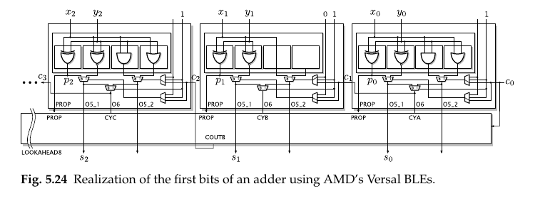

# FPGA Hard Carry Chain Adder

A ripple-carry adder in which the carry recurrence is not built from lookup tables at all but from non-programmable silicon wired directly to the neighbouring logic element, which inverts the usual cost model: the carry becomes the cheapest signal in the datapath instead of the most expensive.

```tikz title="One BLE of an AMD carry chain: the LUT computes the propagate, the hard XOR and mux compute the sum and the carry"
\usepackage{circuitikz}
\begin{document}
\begin{circuitikz}[scale=1.0]
  % --- BLE boundary ---
  \draw[thick] (0,0) rectangle (7.2,4.6);
  \node[font=\scriptsize, anchor=north west] at (0.1,4.55) {one BLE};

  % --- operand inputs ---
  \draw (1.0,5.3) -- (1.0,3.9);  \node[font=\small] at (1.0,5.5) {$y_i$};
  \draw (2.0,5.3) -- (2.0,3.9);  \node[font=\small] at (2.0,5.5) {$x_i$};

  % --- soft logic: the LUT ---
  \draw (0.25,2.9) rectangle (2.75,3.9);
  \node[align=center] at (1.5,3.4)
    {{\small FPGA LUT}\\[1pt]{\scriptsize $p_i = x_i \oplus y_i$}};

  % --- propagate signal ---
  \draw (1.5,2.9) -- (1.5,2.5) -- (5.8,2.5) -- (5.8,1.7);
  \node[font=\small, anchor=south west] at (2.9,2.55) {$p_i$};

  % --- hard logic: sum XOR ---
  \node[xor port, xscale=-1, scale=0.7] (X) at (3.4,1.9) {};
  \draw (4.2,2.5) |- (X.in 1);  \fill (4.2,2.5) circle (1.6pt);
  \draw (4.4,0.6) |- (X.in 2);  \fill (4.4,0.6) circle (1.6pt);
  \draw (X.out) -- (0,1.9) -- (-0.8,1.9);
  \node[font=\small, anchor=east] at (-0.85,1.9) {$s_i$};

  % --- carry in ---
  \draw (-0.8,0.6) -- (5.4,0.6);
  \node[font=\small, anchor=east] at (-0.85,0.6) {$c_i$};

  % --- x_i also feeds the mux ---
  \fill (2.0,4.3) circle (1.6pt);
  \draw (2.0,4.3) -- (4.6,4.3) -- (4.6,1.2) -- (5.4,1.2);

  % --- hard logic: carry mux ---
  \draw (5.4,1.9) -- (5.4,0.3) -- (6.2,0.7) -- (6.2,1.5) -- cycle;
  \node[font=\scriptsize, anchor=west] at (5.46,1.32) {0};
  \node[font=\scriptsize, anchor=west] at (5.46,0.72) {1};
  \node[font=\scriptsize, anchor=west] at (5.87,1.95) {sel};

  % --- carry out ---
  \draw (6.2,1.1) -- (8.0,1.1);
  \node[font=\small, anchor=west] at (8.05,1.1) {$c_{i+1}$};

  \node[font=\scriptsize, anchor=west] at (0,-0.65)
    {every signal 1 bit; $W$ such BLEs abut on dedicated carry wires};
\end{circuitikz}
\end{document}
```

*after Fig. 5.23, p. 126*

**Split the full adder so that only one bit of it is programmable.** For $W$-bit operands $X,Y$ the sum $S$ is $W+1$ bits wide, and every per-bit signal below — $x_i$, $y_i$, $c_i$, $p_i$, $s_i$ — is 1 bit. AMD's series 4–7 and UltraScale/UltraScale+ BLEs contain exactly one XOR gate and one 2:1 multiplexer of hard carry logic. The soft LUT is asked for one function only, the propagate $p_i = x_i \oplus y_i$; the hard logic then closes the adder with

$$s_i = p_i \oplus c_i \tag{5.50}$$
$$c_{i+1} = p_i c_i \vee \overline{p_i}\, x_i \tag{5.51}$$

**Justify (5.51) by case split on $p_i$, not by Boolean algebra.** By the law of excluded middle, either $p_i = 1$ or $p_i = 0$. If $p_i = 1$ then $x_i \neq y_i$, so exactly one operand bit is set and the column sums to $1 + c_i$; the carry out is $c_i$ unchanged. If $p_i = 0$ then $x_i = y_i$, the column sums to $2x_i + c_i$, and the carry out is $x_i$ regardless of $c_i$. Those two branches are precisely the mux of (5.51), and they are the *pass* and *kill/generate* cases of the [[Switched Ripple-Carry Adder]] — this circuit is Zuse's relay switch reborn as a pass transistor. Note that $y_i$ never reaches the hard logic: once $p_i$ is known, $x_i$ carries all the residual information.

**Cost the two paths separately, because the whole architecture turns on their ratio.** For Virtex 6 at the fastest speed grade [Xil14], the carry-in to carry-out delay across a complete slice of four BLEs is at most $0.06$ ns, so each BLE contributes

$$\tau_\text{cp} = \tfrac{0.06}{4} = 0.015\ \text{ns},$$

while the combinational LUT delay is $\tau_\text{LUT} = 0.14\ldots0.32$ ns, the carry-in to BLE output XOR is $\tau_\text{XOR} = 0.21\ldots0.25$ ns, and the worst-case full-adder delay is $\tau_\text{fa} = 0.57$ ns $= 38\,\tau_\text{cp}$ (pp. 126–127). Crossing a bit *inside* the chain is thus $38\times$ cheaper than entering it. Substituting into the ripple-carry delay of [[RCA, Ripple-Carry Adder]],

$$\tau_\text{add}(W) = (W-1)\,\tau_\text{cp} + \max(\tau_\text{cp},\tau_\text{fa}) = 0.015\,(W-1) + 0.57 \ \text{ns} \tag{5.7}$$

giving $0.68$, $0.80$ and $1.04$ ns at $W = 8, 16, 32$. Adding a bit costs 2.6 % of a fixed entry fee.

> [!warning] The book's own numbers do not satisfy its own formula
> p. 127 states that (5.7) yields "about 1, 1.5, and 2.5 ns" at $W = 8, 16, 32$. Those three points lie on the line $0.0625W + 0.5$: a per-bit slope of $0.0625$ ns, i.e. **the whole-slice $0.06$ ns charged once per bit rather than once per four BLEs**, and $\tau_\text{fa} \approx 0.5$ rather than $0.57$. With the page's own $\tau_\text{cp} = 0.015$ and $\tau_\text{fa} = 0.57$, (5.7) gives $0.68$, $0.80$, $1.04$ ns — the $32$-bit figure is off by $2.4\times$. The qualitative conclusion survives (and in fact strengthens: the chain is even cheaper than advertised), but do not quote 1/1.5/2.5 ns.

**Now read the asymptotics backwards.** At $W = 32$ the chain contributes $31 \times 0.015 = 0.465$ ns, under a third of the adder. A prefix network would replace that $0.465$ ns with $\log_2 32 = 5$ levels of $\circ$-nodes — but those nodes are *general fabric*: each costs at least $\tau_\text{LUT} = 0.14$ ns of logic plus the switch-matrix hops between levels, and on an FPGA routing dominates logic. Five fabric levels cannot beat $0.465$ ns of dedicated wire, so [[Parallel Prefix Adders]], [[CLA, Carry-Lookahead Adder]] and [[Carry-Select Adder]] all lose *before they start*. The book states it flatly: *"Fast adder architectures as discussed in Sect. 5.3 are useless when targeting FPGAs for typical sizes (up to 32 bits)"* (p. 134). Combinational speedups begin to pay only beyond **256 bits** [NPP11] (p. 137), which is why FPGA fast-adder research lives in cryptography.

**Versal breaks the chain apart and reassembles it with lookahead.** On Versal the BLE's carry logic no longer contains the XOR; the mux equivalent has moved into a fast carry-lookahead unit, `LOOKAHEAD8` (Fig. 4.5c, p. 91). Of the eight BLEs A–H in a slice only the even carry outputs `COUTB/D/F/H` come from lookahead over the propagates and intermediate carries held in the LUTs; the odd carries are computed in LUT4s as the majority

$$c_{i+1} = x_iy_i\overline{c_i} \vee (x_i \vee y_i)c_i = x_iy_i \vee x_ic_i \vee y_ic_i \tag{5.54–5.56}$$

— the second equality by distributivity of AND over OR, then absorption of $x_iy_ic_i$ into $x_ic_i$ — and passed on through `casc_in`. With no hard XOR left, the sum is rebuilt in a second LUT4 as $s_i = p_i\overline{c_i} \vee \overline{p_i}c_i = p_i \oplus c_i$ (5.52–5.53, p. 127). Carry propagation therefore only ever runs from an even BLE to its odd neighbour, and the lookahead unit covers the rest, yielding adders that stay fast and remain flexible in size **up to 32 bits**.



*Fig. 5.24, p. 128 — cropped rather than redrawn.*

**Intel simply hardens the whole adder.** Each Intel BLE contains a complete full adder with dedicated carry wires to its neighbours, so an RCA maps one-to-one with nothing to configure (p. 128). What remains are placement constraints, not logic ones: ten ALMs per LAB (an ALM being two BLEs with partially shared inputs), and a carry chain may begin only at the first or the sixth ALM of a LAB. The consequence is identical to AMD's — hardened adders plus routing that bypasses the general fabric.

**The prize is not the speed, it is the empty LUT.** A $W$-bit adder occupies $W$ BLEs while asking each 6-input LUT for a single 2-input XOR. Everything left over is free logic sitting directly in front of a full-adder input, and §5.4.3 (p. 129) is a catalogue of what to put there: a third addend, an add/subtract select, an operand multiplexer, a table lookup on fewer than five bits, or partial-product generation for [[Multipliers]]. This is the book's canonical *target-specific optimization*, and it is why the FPGA adder is a building block rather than a leaf — see [[LUT-Merged Adder]] and [[Ternary Adders on FPGAs]].

$$\boxed{\ p_i = x_i \oplus y_i,\quad s_i = p_i \oplus c_i,\quad c_{i+1} = p_i c_i \vee \overline{p_i}\,x_i,\quad \tau_\text{add}(W) = 0.015\,(W-1) + 0.57\ \text{ns}\ }$$

**When it breaks.**

- **Above ~256 bits** the linear term finally dominates the fixed $\tau_\text{fa}$ and trees win; below it every architecture in §5.3 is dead weight on an FPGA. See [[Choosing an Adder]].
- **The chain is a physical column.** Bit $i$ and bit $i{+}1$ must be physically adjacent, so a long adder stretches the placement vertically and cannot be folded; Intel additionally restricts chain starts to ALM 1 or 6 of a LAB. Timing closure failures here are placement failures, not logic failures.
- **You cannot cut it mid-column for free.** The chain is purely combinational; inserting a pipeline boundary costs a BLE for the carry register plus balancing registers — see [[Pipelined Ripple-Carry Adder]], which is the FPGA answer to large $W$ precisely because trees are not.
- **Versal's flexible fast adders stop at 32 bits**; past that the `LOOKAHEAD8` structure no longer covers the width in one shot.
- **Ternary adders on AMD route the carry-save carries through general fabric**, so at small word sizes they are up to 50 % *slower* than the binary adder they were meant to beat.
- **Accumulation loops should not use this at all.** If the result feeds straight back into another addition, keep it redundant — [[CSA, Carry-Save Adder]] has $W$-independent delay and collapses once at the end.
- The adder is exact; every ulp of error in a fixed-point datapath comes from the format alignment of [[Number Formats]] and [[Error Accuracy]], never from the chain.

**RTL (Spade).**

```spade
/// One BLE of an AMD series-4..7 / UltraScale carry chain.
fn ble(x: bool, y: bool, ci: bool) -> (bool, bool) {
    let p = x ^^ y;
    (p ^^ ci, if p { ci } else { x })
}

fn carry_chain<#uint W>(x: uint<W>, y: uint<W>, cin: bool) -> uint<{W + 1}> {
    gen if W == 0 {
        cin.as_uint()
    } else {
        let xb = x.as_bits();
        let yb = y.as_bits();
        let (s0, c1) = ble(xb[0], yb[0], cin);
        let hi: uint<W> = carry_chain::<{W - 1}>(xb[1..W].as_uint(), yb[1..W].as_uint(), c1);
        hi.concat(s0.as_uint())
    }
}
```

`ble` is exactly the box in the diagram: `p` is the LUT output, `p ^^ ci` the hard XOR, and the `if p { ci } else { x }` the hard mux of (5.51) — `^^` because `^` is not defined on `bool` in Spade. `carry_chain` is the dedicated wire: the tuple's second element is the only value passed between recursion levels, so the recursion depth *is* the carry chain and each level's `hi` is $W$ bits wide, making the result $W+1$. `concat` on integers puts its left argument high, which is what places $s_0$ in the LSB; `.as_bits()` indexes from the LSB, so `xb[0]` is bit 0. The whole thing is combinational — the BLE registers that a real design would use on `s_i` are outside this entity. Synthesis will *not* build the mux from fabric: `if p { ci } else { x }` next to a carry is the pattern every vendor's inference engine matches onto `CARRY4`/`CARRY8` or the Intel hard FA, which is the entire point of the note.

## References

de Dinechin & Kumm, *Application-Specific Arithmetic*, Springer 2024, Ch. 5 "Fixed-Point Addition":

- §5.4 Adders on FPGAs — p. 125 (the two particularities)
- §5.4.1 Addition support on AMD FPGAs — pp. 126–128 (Eqs. 5.50–5.56; Figs. 5.23, 5.24; Virtex 6 timing from [Xil14])
- §5.4.2 Addition support on Intel FPGAs — p. 128 (ALM/LAB placement constraints)
- §5.4.3 Merging additional functionality in an adder — pp. 129–130 (Eqs. 5.57–5.60; Fig. 5.25)
- §5.5 Fast adders on FPGAs — pp. 134, 137 (the "useless below 32 bits" claim; the 256-bit crossover from [NPP11])
- §5.2.2 for (5.7), p. 108

**Related notes.**

- [[RCA, Ripple-Carry Adder]] – depends-on: supplies the recurrence and the delay model (5.7) that this note substitutes FPGA numbers into.
- [[Switched Ripple-Carry Adder]] – depends-on: the mux form of the FA that the AMD carry logic implements literally.
- [[FPGAs]] – depends-on: the BLE, slice and LAB structure the chain is hardened into.
- [[Lookup-Tables]] – supports: explains why one 2-input XOR leaves a 6-LUT nearly empty.
- [[Parallel Prefix Adders]] – counter-example: the asymptotically better architecture that loses here until $W$ passes 256.
- [[Choosing an Adder]] – compares: places this against every sibling by target technology.
- [[LUT-Merged Adder]] – extends: spends the idle LUT in front of each carry-chain input.
- [[Ternary Adders on FPGAs]] – extends: spends that same idle LUT on a carry-save layer above the chain.
- [[Pipelined Ripple-Carry Adder]] – extends: the FPGA way to grow past the widths where the chain alone stops closing timing.
- [[AAM Carry-Select Adder]] – extends: reuses a second carry chain as the selection network for $W \geq 256$.
