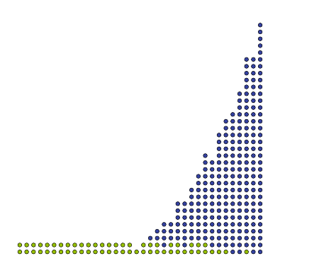

# Small-Angle Taylor Sine and Cosine

The two-term Taylor kernel $\sin Z\approx Z-\frac{Z^3}{6}$, $\cos Z\approx1-\frac{Z^2}{2}$ evaluated on an argument already reduced below $2^{-\alpha}$ — the one polynomial evaluator whose every coefficient is a power of two or a power of two over three, so it costs no coefficient multiplier at all.

```tikz title="Small-angle Taylor datapath: Z, Z squared over 2, and Z minus Z cubed over 6"
\usepackage{circuitikz}
\usetikzlibrary{arrows}
\begin{document}
\begin{circuitikz}[font=\small,
    blk/.style={draw,thick,minimum width=1.6cm,minimum height=0.66cm,fill=white},
    w/.style={->,>=latex,thick},
    lab/.style={font=\footnotesize}]

  % input
  \draw[w] (0,5.75) -- (0,5.06);
  \node[lab,anchor=west] at (0.14,5.5) {$Y_{\mathrm{red}}$, $-\ell-2-\alpha$ b};
  \node[blk] (pi) at (0,4.72) {$\times\,\pi$};

  % Z bus
  \draw[thick] (0,4.39) -- (0,3.95);
  \draw[thick] (-2.7,3.95) -- (1.75,3.95);
  \node[lab,anchor=east] at (-2.86,3.95) {$Z$\,: $-\alpha-\ell+g$ b\ (22)};

  \draw[w] (-2.7,3.95) -- (-2.7,3.39);
  \draw[w] ( 1.75,3.95) -- ( 1.75,3.39);
  \draw[thick] (-0.55,3.95) -- (-0.55,2.15);

  \node[blk] (sq)  at (-2.7,3.06) {$Z^2/2$};
  \node[blk] (cub) at ( 1.75,3.06) {$Z^3/6$};

  % squarer output straight down
  \draw[w] (-2.7,2.73) -- (-2.7,0.62);
  \node[lab,anchor=east] at (-2.84,1.55) {$-2\alpha-1-\ell+g$ b\ (15)};
  \node[lab,anchor=north] at (-2.7,0.55) {$\dfrac{Z^2}{2}$};

  % cube output routes into the subtractor
  \draw[thick] (1.75,2.73) -- (1.75,2.15) -- (0.55,2.15);
  \node[lab,anchor=west] at (1.87,2.45) {$-3\alpha-2-\ell+g$ b\ (8)};
  \draw[w] (-0.55,2.15) -- (-0.55,1.99);
  \draw[w] ( 0.55,2.15) -- ( 0.55,1.99);

  \node[blk] (sub) at (0,1.66) {$-$};

  \draw[w] (0,1.33) -- (0,0.62);
  \node[lab,anchor=west] at (0.12,1.0) {22 b};
  \node[lab,anchor=north] at (0,0.55) {$Z-\dfrac{Z^3}{6}$};
\end{circuitikz}
\end{document}
```

*after the $Z$ datapath of Fig. 20.11, p. 617; parenthesised widths are the instance $\ell=-24$, $g=4$, $\alpha=6$*

**Prefer Taylor to minimax here, for two reasons that are both about cost, not accuracy.** [[Polynomial Approximation]] would normally beat a Taylor series outright: for a fixed degree the minimax polynomial has a strictly smaller sup-norm error, by the equioscillation theorem. Two things reverse that on this particular argument. First, sine is odd and cosine is even, so their Taylor series have only odd and only even terms respectively — a degree-$d$ approximation costs about $d/2$ multiplications instead of $d$. A minimax polynomial has all $d+1$ coefficients nonzero and throws that saving away. Second, up to degree 4 the Taylor coefficients are $1$, $\tfrac12$, $\tfrac16$, $\tfrac1{24}$ — powers of two, or powers of two times $\tfrac13$. A power-of-two coefficient is a hardwired shift and costs nothing; $\tfrac13$ is the cheapest non-dyadic constant there is ([[Division by Constants]]). Minimax coefficients are arbitrary $(-\ell)$-bit constants, each of which buys a constant multiplier. So the honest comparison is not "which polynomial is more accurate at degree 3" but "which is cheaper at the degree that meets half an ulp", and here Taylor wins on both counts.

**Truncate each series after two terms.** With the argument already reduced to an octant and split by the second argument reduction (see [[Table-and-Multiplier Sine and Cosine]]), set $Z=\pi Y_\text{red}$ with $Y_\text{red}\in[0,2^{-2-\alpha})$. Then $Z<3.15\cdot2^{-2-\alpha}<2^{-\alpha}$: the leading bit of $Z$ has weight $2^{-\alpha-1}$, and the $\pi$ that produced it is a constant multiplication, not a general one. Keeping two terms of each series (20.15) and (20.17):

$$\sin Z\approx Z-\frac{Z^3}{6},\qquad \cos Z\approx1-\frac{Z^2}{2}\tag{20.46–20.47}$$

**Bound the remainder, and the bound becomes the sizing rule for $\alpha$.** Taylor's theorem with the Lagrange remainder gives, since the neglected terms alternate and decrease in magnitude for $|Z|<1$, that each remainder is bounded by its own first neglected term:

$$\delta_{\text{Taylor}(\cos)}=\cos Z-\left(1-\tfrac{Z^2}{2}\right)\approx\frac{Z^4}{24},\qquad \delta_{\text{Taylor}(\sin)}=\sin Z-\left(Z-\tfrac{Z^3}{6}\right)\approx\frac{Z^5}{120}$$

Substituting $Z<2^{-\alpha}$ and rounding $24>2^4$, $120>2^6$ downward gives $\delta_{\text{Taylor}(\cos)}<2^{-4\alpha}/24<2^{-4\alpha-4}$ and $\delta_{\text{Taylor}(\sin)}<2^{-5\alpha}/120<2^{-5\alpha-6}$. The cosine remainder dominates. Crucially, in the addition formulas $\sin(\pi Y')=\sin(\pi A)\cos Z+\cos(\pi A)\sin Z$ these remainders are multiplied by a sine or a cosine, both bounded by $1$ in absolute value, so they are **not amplified** — the polynomial's error passes through the recombination untouched. Requiring the dominant one below half an ulp of the final result, $2^{-4\alpha-4}<2^{\ell}$, and taking $\log_2$:

$$\alpha>-\frac{\ell}{4}-1\tag{20.52}$$

The table that the head of the split addresses is therefore indexed by roughly a **quarter** of the input bits, which is where the whole architecture's area advantage comes from. See [[Error Accuracy]] for the ulp and half-ulp conventions this uses.

**Never build $\cos Z$; build $Z^2/2$.** $\cos Z$ is a number very close to $1$, so a product $\sin(\pi A)\times\cos Z$ wastes a full-width multiplier computing digits that barely move. Substituting (20.47) and distributing:

$$\sin(\pi A)\times\left(1-\frac{Z^2}{2}\right)=\sin(\pi A)-\sin(\pi A)\times\frac{Z^2}{2}$$

The remaining product has $\frac{Z^2}{2}<2^{-2\alpha-1}$ as one operand, so it is a much narrower multiplier plus one addition. The same rewriting applies to $\cos(\pi A)\times\cos Z$. This is why the datapath above emits $\frac{Z^2}{2}$ and $Z-\frac{Z^3}{6}$ rather than $\cos Z$ and $\sin Z$: the two quantities a consumer actually wants are the *deviations*, not the function values.

**Every wire's width follows from an MSB bound and one shared LSB.** All internal signals are truncated to the same LSB $2^{\ell-g}$, where $g$ is the guard-bit count; the MSB of each comes from the bound above it. Writing widths as (MSB position $-$ LSB position):

| signal | MSB weight | width in bits | at $\ell=-24$, $g=4$, $\alpha=6$ |
| --- | --- | --- | --- |
| $Y_\text{red}$ | $2^{-\alpha-2}$ | $-\ell-2-\alpha$ | 16 |
| $Z$, $Z-\frac{Z^3}{6}$ | $2^{-\alpha}$ | $-\alpha-\ell+g$ | 22 |
| $\frac{Z^2}{2}$ | $2^{-2\alpha-1}$ | $-2\alpha-1-\ell+g$ | 15 |
| $\frac{Z^3}{6}$ | $2^{-3\alpha-2}$ | $-3\alpha-2-\ell+g$ | 8 |

*Table 20.2, p. 618.* All four are unsigned, since the octant reduction of [[Octant Argument Reduction]] leaves $Y_\text{red}\ge0$. The pattern is that each extra power of $Z$ buys $\alpha$ free leading zeros, so the cube is a quarter the size of the linear term — the reason the cubic correction is nearly free while the linear term dominates the area.

**Build $\frac{Z^2}{2}$ as a truncated squarer or a table; the table is the more accurate of the two.** A truncated squarer ([[Squarers and Integer Powers]]) discards low partial products and its error is bounded by one ulp of the result; a tabulation is a correctly-rounded lookup and its error is bounded by *half* an ulp. Since the guard-bit budget is a count of ulps, halving one of the terms is worth having, so tabulate whenever the table fits. Note that the $/2$ itself is free: it is a shift of the squarer's output, absorbed into the wiring, so the "divide by two" in the formula never becomes hardware. That asymmetry with the cube is the whole reason $\cos Z$ is the cheap half of the pair.

**Size the cube's table by the derivative, not by $Z$'s width.** The book computes $\frac{Z^3}{6}$'s *output* width and then says it can "simply be tabulated", which is only sensible once you notice that its *input* need not be the full 22-bit $Z$. Truncate $Z$ to $\hat Z$ at LSB $2^{-t}$; by the mean value theorem the induced error is $\frac{Z^3}{6}-\frac{\hat Z^3}{6}\le\frac{Z^2}{2}\,(Z-\hat Z)<2^{-2\alpha-1}\cdot2^{-t}$. Requiring that below the datapath LSB $2^{\ell-g}$ gives $t\ge-\ell+g-2\alpha$, so the address is only

$$t-\alpha=-\ell+g-3\alpha \ \text{ bits}$$

— 10 bits at our instance, for a $1024\times8$ = 1 kbit ROM, which on an FPGA is one block RAM in its narrowest configuration and on an ASIC a small ROM macro. The book leaves this truncation "as an exercise to the reader" (p. 618) alongside its analysis of the two multipliers; the derivation above is that exercise.

**For large $\ell$, fuse the whole thing into one bit heap.** Once $\ell$ is large enough that the cube's table stops fitting, an ad hoc architecture computes $Z-\frac{Z^3}{6}$ inside a single [[Bit Heaps]] compression tree instead of as a table plus a subtractor. The subtraction disappears — the cube's bits enter the same heap as $Z$'s, complemented — and only the handful of columns that carry the cube need dividing by 3, using the divide-by-3 variant of [[Division by Constants]] rather than a general divider.



*Fig. 20.12, p. 619 (cropped). The long low row of light dots is $Z$ itself; the tall narrow triangle on the right is the cube's contribution, confined to the least significant quarter of the columns exactly as the width table predicts.*

**Do not reach for Horner.** [[Horner Evaluation]] would factor the sine as $Z\left(1-\frac{Z^2}{6}\right)$, which looks cheaper — one squarer and one multiply. But that final multiply is $Z\times(\cdot)$, a **full-width** $22\times22$ product, whereas the expanded form needs only the 8-bit cube subtracted from $Z$. Horner minimises the *number* of multiplications; here the binding constraint is their *width*, and the two objectives point opposite ways. Horner is the right factorisation for a dense minimax polynomial and the wrong one for a sparse series with a tiny leading correction.

$$\boxed{\ \sin Z\approx Z-\frac{Z^3}{6},\quad \cos Z\approx1-\frac{Z^2}{2},\quad\text{valid to half an ulp iff }\ \alpha>-\frac{\ell}{4}-1\ }$$

## When it breaks

- **$\alpha$ at or below $-\ell/4-1$.** The cosine remainder $2^{-4\alpha-4}$ crosses half an ulp and last-bit accuracy is lost. The fix is a bigger table, not a longer series — see the next item.
- **Degree 5 is not free.** The cheap-coefficient argument stops at degree 4: $\frac{1}{120}=\frac{1}{8}\cdot\frac{1}{15}$, and $\frac1{15}$ is neither a power of two nor a power of two over three, so a fifth-order term costs a real constant multiplier. Enlarging $\alpha$ is almost always cheaper than adding a term.
- **Small $\ell$.** At small enough precisions the whole apparatus loses to a plain table over the octant, and FloPoCo degrades through first-order ($\sin Z\approx Z$, $\cos Z\approx1$) and second-order variants before reaching this one; the book gives the ladder but no crossover sizes (p. 620). Computing just right sometimes means not computing at all.
- **$Z$ not actually small.** The series is only two-term-accurate because the argument reduction guarantees $Z<2^{-\alpha}$. Applied to a full octant, $Z<\pi/4$, two terms give an error near $10^{-3}$ — useless. The polynomial is inseparable from the reduction that feeds it.
- **The guard-bit count is not yours to set here.** $g=4$ comes from the *whole* architecture's error budget, not from this kernel alone; changing the squarer from table to truncated squarer moves one half-ulp to a full ulp and the budget must be rechecked. See [[Table-and-Multiplier Sine and Cosine]].

## RTL (Spade)

```spade
// Small-angle Taylor kernel, instantiated at l = -24, g = 4, alpha = 6.
// Z = z * 2^-28 with Z < 2^-6, so z is 22 bits (= -alpha - l + g).
fn taylor_kernel(z: uint<22>) -> (uint<15>, uint<22>) {
    let sq: uint<44> = z * z;
    let half_sq: uint<15> = trunc(sq >> 29);          // Z^2/2, MSB 2^-13
    let cube: uint<88> = sq * zext::<22, 44>(z);
    let c: uint<10> = trunc(cube >> 56);              // Z^3, aligned to the datapath LSB
    let sixth: uint<8> = trunc(c `std::ops::comb_div` 6);
    let sixth_z: uint<22> = zext(sixth);
    (half_sq, z -. sixth_z)
}
```

`z` is the $Z$ bus of the diagram, `half_sq` the left output and the tuple's second element the right one; in the emitted Verilog they arrive packed as `output__[36:22]` and `output__[21:0]`. Everything is combinational — there is no `reg`, and the whole kernel is one cone of logic between the constant multiplier and the recombination adders. The `>> 29` and `>> 56` are the diagram's implicit truncations and are pure wiring, which is why $Z^2/2$ never pays for its division by two. Synthesis will differ from the drawing in two places: the 88-bit product is written for clarity but only its top 10 bits are used, so a synthesiser prunes it to a truncated cube (and a real design tabulates it from 10 address bits instead); and `comb_div` by the literal 6 is a general divider standing in for the shift-plus-divide-by-3 of [[Division by Constants]], which is the structure you would actually instantiate on 10 bits.

Simulated against a behavioural reference over 7 named vectors — including $z=\mathtt{0x200001}$, whose MSB and LSB differ so a reversed bit order fails — plus 5000 random ones: 5007/5007 match.

## Related Notes

- [[Table-and-Multiplier Sine and Cosine]] – depends-on: supplies the reduced argument $Y_\text{red}$ and consumes $\frac{Z^2}{2}$ and $Z-\frac{Z^3}{6}$ through the addition formulas; owns the guard-bit budget this kernel spends.
- [[Octant Argument Reduction]] – depends-on: guarantees the $Z<2^{-\alpha}$ bound without which two terms are not enough.
- [[Polynomial Approximation]] – compares: the general minimax machinery this beats on cost, and the one to fall back to when the coefficients stop being free.
- [[Horner Evaluation]] – counter-example: minimises multiplication count, which is the wrong objective when the leading correction is a quarter-width cube.
- [[Squarers and Integer Powers]] – supports: the truncated squarer alternative for $\frac{Z^2}{2}$, one ulp against the table's half.
- [[Division by Constants]] – supports: the divide-by-3 that makes $\frac16=\frac12\cdot\frac13$ affordable on the few columns that need it.
- [[Bit Heaps]] – extends: fuses the cube, the subtraction and the divide-by-3 into a single compression tree for large $\ell$.
- [[Number Formats]] – depends-on: the fixed-point MSB/LSB notation every width in the table is written in.

## References

- de Dinechin & Kumm, *Application-Specific Arithmetic*, Springer 2024.
  - §20.5.1 *Algorithm*, pp. 615-616 — (20.44)-(20.47), the $\cos Z\approx1$ rewriting, why Taylor beats minimax here.
  - §20.5.1.1 *Architectural Constraints from Approximation Error Analysis*, p. 616 — (20.50)-(20.52).
  - §20.5.2, Tables 20.2 and 20.3, p. 618 — internal formats and truncations; the cube's input truncation is left as an exercise there.
  - §20.5.3 *Architectural Details*, pp. 618-619 — squarer versus table, the single-bit-heap variant.
  - Fig. 20.11, p. 617 (the $Z$ datapath, redrawn); Fig. 20.12, p. 619 (cropped).
