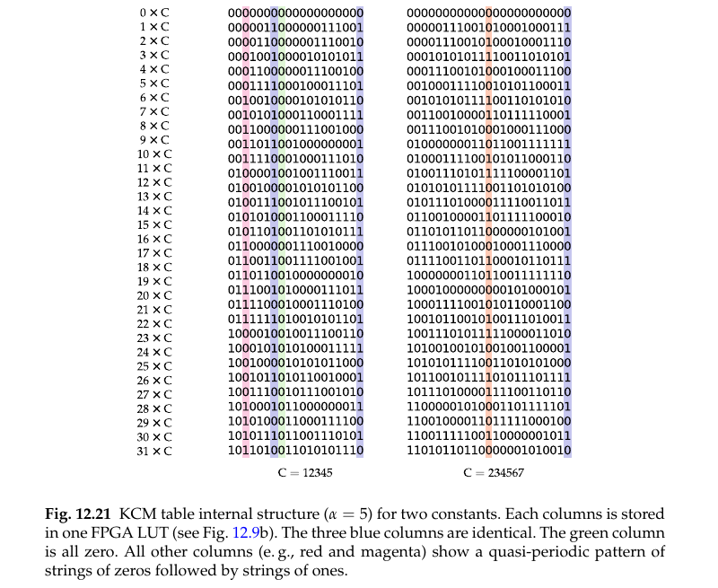

# Table-Based Multiple Constant Multiplication

Multiple constant multiplication built from [[KCM, Table-Based Constant Multiplication]] tables instead of adder graphs, where the shared resource is not an intermediate sum but the *contents* of the FPGA lookup tables.

```tikz title="Two KCM constant multipliers sharing a column LUT"
\usepackage{circuitikz}
\begin{document}
\begin{circuitikz}
\footnotesize
% --- input word, split into two alpha=4 bit chunks -----------------------
\node[draw,minimum width=2.6cm,minimum height=0.5cm] at (0,1.9) {};
\draw (0,1.65) -- (0,2.15);
\node[font=\tiny] at (-0.65,1.9) {$X_1$};
\node[font=\tiny] at ( 0.65,1.9) {$X_0$};
\node[left,font=\small] at (-1.35,1.9) {$X$};
\node[font=\tiny,anchor=west] at (1.4,1.9) {$w_X=8$};

% --- four chunk tables: two constants x two chunks -----------------------
\foreach \gx/\lab in {-4.6/{T_{1,1}}, -2.9/{T_{1,0}}, 2.9/{T_{2,1}}, 4.6/{T_{2,0}}} {
  \foreach \k in {0,...,5} {
    \draw (\gx-0.66+\k*0.22,-0.30) rectangle (\gx-0.44+\k*0.22,0.20);
  }
  \node[font=\tiny] at (\gx,-0.55) {$\lab$};
}
% the two 1-bit tables that hold identical contents
\fill[black!25] (-2.46,-0.30) rectangle (-2.24,0.20);
\fill[black!25] ( 5.04,-0.30) rectangle ( 5.26,0.20);
\draw (-2.46,-0.30) rectangle (-2.24,0.20);
\draw ( 5.04,-0.30) rectangle ( 5.26,0.20);

\node[font=\tiny,anchor=south] at (-3.75,0.42) {$C_1=12345$};
\node[font=\tiny,anchor=south] at ( 3.75,0.42) {$C_2=234567$};

% --- chunk fan-out: one input, both constants ---------------------------
\draw[->] (-0.65,1.65) -- (-0.65,1.15) -| (-4.6,0.20);
\draw[->] (-0.65,1.15) -| (2.9,0.20);
\draw[->] ( 0.65,1.65) -- (0.65,0.85) -| (-2.9,0.20);
\draw[->] ( 0.65,0.85) -| (4.6,0.20);
\node[font=\tiny,anchor=south] at (-3.6,1.15) {$\alpha=4$};
\node[font=\tiny,anchor=south] at ( 2.0,0.85) {$\alpha=4$};

% --- one adder per constant --------------------------------------------
\node[draw,circle,inner sep=1pt,font=\small] (a1) at (-3.75,-1.5) {$+$};
\node[draw,circle,inner sep=1pt,font=\small] (a2) at ( 3.75,-1.5) {$+$};
\draw[->] (-4.6,-0.75) |- (a1.west);
\draw[->] (-2.9,-0.75) |- (a1.east);
\draw[->] ( 2.9,-0.75) |- (a2.west);
\draw[->] ( 4.6,-0.75) |- (a2.east);
\node[font=\tiny,anchor=east] at (-4.65,-1.15) {$\ll\alpha$};
\node[font=\tiny,anchor=east] at ( 2.80,-1.15) {$\ll\alpha$};
\draw[->] (a1.south) -- (-3.75,-2.2) node[below,font=\small] {$C_1X$};
\draw[->] (a2.south) -- ( 3.75,-2.2) node[below,font=\small] {$C_2X$};
\node[font=\tiny,anchor=west] at (-3.7,-1.95) {$26$};
\node[font=\tiny,anchor=west] at ( 3.8,-1.95) {$26$};

% --- what the strips are ------------------------------------------------
\node[font=\tiny,align=center] at (0,-0.15)
  {each strip:\\$w_C+\alpha$ columns,\\one $\alpha$-LUT each};
\node[font=\tiny,align=center] at (0,-3.05)
  {shaded column $j=0$ holds $x_0$ in both tables: identical contents,\\one physical $\alpha$-LUT serves both constant multipliers};
\end{circuitikz}
\end{document}
```

**Find what is left to share once the adders are gone.** Shift-and-add [[Multiple Constant Multiplication]] shares *intermediate factors*: $\{19,43\}$ costs three adders instead of five because $43=19\cdot2+5$. A KCM multiplier has almost no intermediates to share — for $w_X$ input bits and $\alpha$-bit chunks it is $D=\lceil w_X/\alpha\rceil$ tables and $D-1$ adders, and those adders carry constant-specific values that two different constants will not agree on. What the two multipliers *can* agree on is the contents of a table, because both tables are addressed by the same chunk $X_k$ of the same input $X$. Table-based MCM is therefore MCM whose sharing happens entirely inside the lookup tables (p. 407).

**Decompose a table into independent one-bit tables.** This is the step that makes the sharing plausible at all. Table $T_{i,k}$ maps an $\alpha$-bit chunk to the $(w_C+\alpha)$-bit product $C_iX_k$, but an FPGA LUT is a *one-bit* function of $\alpha$ address bits, so the mapper does not build one $(w_C+\alpha)$-bit-wide memory: it builds $w_C+\alpha$ separate $\alpha$-input LUTs, one per output column (Fig. 12.9b, p. 383). The unit of sharing is consequently a **column**, not a table — two constant multipliers need not have identical products, only one bit position where their products agree across all $2^\alpha$ chunk values. Writing $x$ for the chunk, column $j$ of constant $C$'s table is

$$c^{C}_{j}(x)\;=\;\left\lfloor \frac{xC}{2^{j}} \right\rfloor \bmod 2, \qquad x\in\{0,\dots,2^{\alpha}-1\}$$

a $2^\alpha$-bit vector with one bit per LUT address — exactly the LUT's configuration word, so "identical contents" means literally equal vectors.

**Count the space and it looks hopeless.** An $\alpha$-input LUT has $2^{2^{\alpha}}$ possible fillings: $65536$ for $\alpha=4$, over $4\times10^{9}$ for $\alpha=5$, $1.8\times10^{19}$ for $\alpha=6$. If table contents were arbitrary bit patterns, a design with a few dozen tables would never see a collision and the idea would die here. Faust et al. observed that they are very far from arbitrary (p. 407), and the reason is visible in the closed form above.

**Split the columns into two regimes, and neither is random.** By the modular identity $xC \bmod 2^{j+1} = \big(x\,(C\bmod 2^{j+1})\big)\bmod 2^{j+1}$, column $j$ depends on the constant *only through $C\bmod 2^{j+1}$* — the high bits of $C$ are invisible to the low columns. For $j=0$ this collapses to two possibilities: $c_0(x)=0$ for even $C$, and $c_0(x)=x_0$ for odd $C$, so **every odd constant in the design shares its column-0 LUT**, whatever the constants are. That is the shaded cell in the diagram. In the opposite regime $2^{j}>C$, write $\theta=C/2^{j}<1$; then $\lfloor x\theta\rfloor$ increases by $0$ or $1$ at each step, so the parity toggles once every $\approx 1/\theta = 2^{j}/C$ addresses and the column is a run pattern whose runs all have length $\lfloor 2^{j}/C\rfloor$ or $\lceil 2^{j}/C\rceil$ — a *mechanical* (Sturmian) word of slope $\theta$. That is precisely the book's "quasi-periodic pattern of strings of zeros followed by strings of ones", and it is a one-parameter family sampled at $2^\alpha$ points, not a free choice among $2^{2^\alpha}$ fillings. Enumerating the $\alpha=4$ column set confirms it: $51$ of the $52$ reachable columns have all their interior runs equal to within one.



*after Fig. 12.21, p. 408 — cropped. Rows are $i\times C$ for $i=0\ldots31$; each printed column is one FPGA LUT.*

**The count that results is tiny.** For $\alpha=4$, over all signed products by every integer constant from $1$ to $2^{12}$ — chunks $x\in[-8,7]$, two's-complement output columns as in [[Number Formats]] — only $52$ distinct one-bit tables occur, out of $2^{2^4}=65536$ (Faust et al., p. 407). Re-running that enumeration reproduces $52$ exactly; extending it gives $16$ ($\alpha=3$), $52$ ($\alpha=4$), $176$ ($\alpha=5$), $680$ ($\alpha=6$). The reachable set grows like a small power of $2^{\alpha}$ while the space containing it grows doubly exponentially, and that gap is the entire resource.

$$\boxed{\ c^{C}_{j}(x)=\left\lfloor \tfrac{xC}{2^{j}} \right\rfloor \bmod 2 \quad\Longrightarrow\quad \big|\{c^{C}_{j}\}\big| = 52 \ \text{ for } \alpha=4,\ 1\le C\le 2^{12}\ }$$

**Widen the sharing by letting the constants move.** Exact constants give whatever collisions arithmetic happens to give. Aksoy et al. instead let each $C_i$ vary inside a small error interval — the same slack [[Fix-by-Real KCM]] spends on narrow tables, bounded as in [[Error Accuracy]] — and pick the combination maximising coincident columns with a 0-1 ILP, reporting **up to $20\%$ fewer architectural LUTs** than the fixed-constant design (p. 407). Kumm et al. went the other way and folded table-based multipliers into an ILP formulation of the shift-and-add MCM problem, so one solver chooses per coefficient between an adder graph and a table (p. 407).

**Where this wins.** The general result across these works is that on FPGAs a table-based method gives lower area *and* better delay than shift-and-add MCM **for low input word sizes** (p. 407) — the regime where $D=\lceil w_X/\alpha\rceil$ is $1$ or $2$, so the operator is one LUT deep plus at most one adder while an adder graph is still several adders deep. See [[Lookup-Tables]] for why a 1-bit $\alpha$-input function is the unit of FPGA area, and [[FPGAs]] for the fabric the whole argument rests on.

> [!warning] The book gives no numbers for the shared implementation, and no mechanism
> pp. 407–408 report the $52$-table result and the $20\%$ ILP improvement but never state the LUT count of a concrete shared MCM operator, nor its delay, nor whether the sharing must be forced by the generator or is simply found by the vendor mapper's common-subfunction merging. Reproducing the area claim needs outside research.

**When it breaks.**

- Sharing is only legal between tables **addressed by the same signal**. Identical columns in $T_{i,k}$ and $T_{i',k'}$ with $k\ne k'$ cannot merge: they read $X_k$ and $X_{k'}$, different wires. All sharing is within one chunk index, so the pool is $N$ constants deep, not $ND$ tables.
- It saves table LUTs, never adder LUTs. Per constant the tables cost $D(w_C+\alpha)$ LUTs and the rake $(D-1)w_C$, so as $D$ grows the table share tends to $\frac{w_C+\alpha}{2w_C+\alpha}\approx\tfrac12$. Even free tables cannot halve a wide-input KCM.
- The $52$ is specific to $\alpha=4$ and $C\le2^{12}$. At $\alpha=6$ the reachable set is already $680$, while a design with a handful of coefficients draws only a few dozen columns — so the collision probability *falls* as $\alpha$ rises, the opposite of the intuition that bigger LUTs share more.
- $w_X\le\alpha$ removes the problem entirely: one table, no chunking, no adder, and [[Tabulated Constant Multiplier]] is the whole operator.
- ASIC has no LUTs and no configuration words to compare, so none of this exists there; shift-and-add wins unconditionally (p. 418). See [[Choosing a Constant Multiplier]].

**RTL.** The datapath is two ordinary KCMs on one input; the sharing is a mapping consequence, so what the RTL must get right is the chunking and the alignment, not the merge.

```spade
// alpha = 4, w_X = 8  ->  D = 2 chunk tables per constant.
fn tbl(c: uint<26>, xk: uint<4>) -> uint<26> {
    trunc(c * zext::<4, 26>(xk))
}

entity mcm_tab(x: uint<8>) -> (uint<26>, uint<26>) {
    let x0: uint<4> = trunc(x);
    let x1: uint<4> = trunc(x >> 4);
    let r1: uint<26> = trunc(tbl(12345, x0) + (tbl(12345, x1) << 4));
    let r2: uint<26> = trunc(tbl(234567, x0) + (tbl(234567, x1) << 4));
    (r1, r2)
}
```

`x0` and `x1` are the two chunk wires leaving the split box, each `tbl` call is one strip of column LUTs in the drawing, and `<< 4` is the $\ll\alpha$ alignment on the high table's output. Widths: the chunk is $\alpha=4$ bits, a table output needs $w_C+\alpha$ bits ($18$ for $12345$, $22$ for $234567$), and both are carried in $26$ because $234567\cdot255<2^{26}$; `trunc` discards the growth Spade's type system attaches to `*` and `+`. Everything is combinational — no `reg` — so the operator is one LUT delay plus one adder. **What synthesis does differently from the drawing:** it never builds a multiplier. `c` is constant, so `c * zext(xk)` collapses to $w_C+\alpha$ four-input truth tables, and it is those truth tables — not any structure written above — that get deduplicated. The shared cell in the diagram is an output of technology mapping, not of the HDL.

**Related Notes.**

- [[KCM, Table-Based Constant Multiplication]] – depends-on: the single-constant operator whose tables are the objects being shared; chunking, the $D$ count and the adder rake are defined there.
- [[Multiple Constant Multiplication]] – compares: the shift-and-add answer to the same problem, sharing adders instead of LUT contents; Kumm et al. put both in one ILP.
- [[Lookup-Tables]] – supports: why an $\alpha$-input 1-bit function is the unit of area, which is what makes column-level sharing the only sharing that exists.
- [[Choosing a Constant Multiplier]] – compares: places the "low input word size" win against every sibling technique.
- [[Fix-by-Real KCM]] – extends: supplies the per-constant error interval that Aksoy et al.'s ILP spends on extra collisions.
- [[Tabulated Constant Multiplier]] – counter-example: below $\alpha$ input bits the chunking vanishes and there is nothing left to share.

## References

- de Dinechin & Kumm, *Application-Specific Arithmetic*, Springer 2024.
  - §12.5.2 *Table-Based Multiple Constant Multiplication*, p. 407 — the $52$-table result (Faust et al.), the error-interval ILP (Aksoy et al.), the ILP integration (Kumm et al.), and the low-word-size verdict.
  - Fig. 12.21, p. 408 — KCM table internal structure for $\alpha=5$, $C\in\{12345,234567\}$ (cropped above).
  - §12.2, pp. 383–385 — KCM chunking, the $D(w_C+\alpha)$ LUT count, and Fig. 12.9b's one-LUT-per-column mapping.
  - §12.7, p. 418 — the ASIC/FPGA split.
- Column enumeration for $\alpha\in\{3,4,5,6\}$ recomputed directly from $c^{C}_{j}(x)=\lfloor xC/2^{j}\rfloor\bmod2$; the $\alpha=4$ signed case reproduces the book's $52$.
