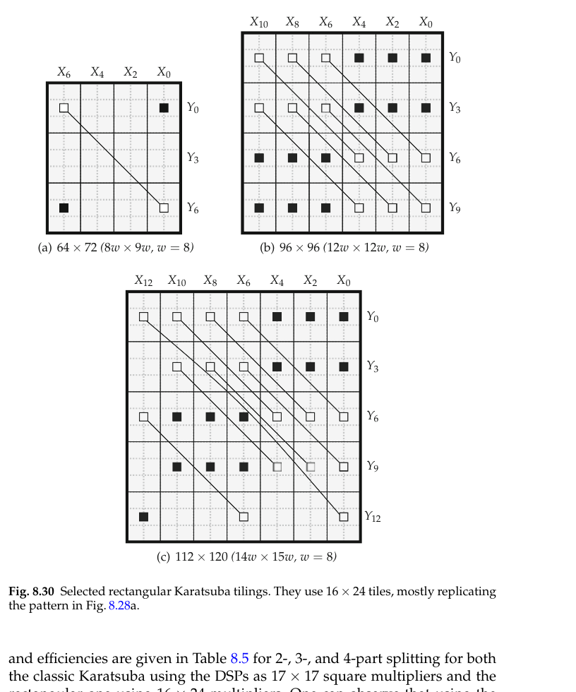

# Rectangular Karatsuba

Karatsuba pairing applied to *rectangular* sub-multipliers, so the pattern is set by $\gcd(w_X,w_Y)$ rather than by a square splitting, and a DSP block is used as $16\times24$ instead of being cut down to $17\times17$.

```tikz title="Minimal rectangular Karatsuba pattern: 64x72 from 16x24 tiles"
\usepackage{circuitikz}
\begin{document}
\begin{circuitikz}[scale=1,font=\footnotesize]
  % 4 columns of 16 bits (X), 3 rows of 24 bits (Y)
  \foreach \c in {0,1,2,3,4} \draw[gray!60] (\c*0.9,0) -- (\c*0.9,-3.6);
  \foreach \r in {0,1,2,3} \draw[gray!60] (0,-\r*1.2) -- (3.6,-\r*1.2);
  \draw[very thick] (0,0) rectangle (3.6,-3.6);

  % column labels: X chunk i carries label X_{2i}, rightmost is X_0
  \node[anchor=south] at (3.15,0.05) {$X_0$};
  \node[anchor=south] at (2.25,0.05) {$X_2$};
  \node[anchor=south] at (1.35,0.05) {$X_4$};
  \node[anchor=south] at (0.45,0.05) {$X_6$};
  % row labels: Y chunk j carries label Y_{3j}, topmost is Y_0
  \node[anchor=west] at (3.68,-0.6) {$Y_0$};
  \node[anchor=west] at (3.68,-1.8) {$Y_3$};
  \node[anchor=west] at (3.68,-3.0) {$Y_6$};

  % the paired tiles, same weight 2^{48}
  \draw[thick] (0.45,-0.6) -- (3.15,-3.0);
  \draw[fill=white,thick] (0.28,-0.43) rectangle (0.62,-0.77);
  \draw[fill=white,thick] (2.98,-2.83) rectangle (3.32,-3.17);
  % the two reused products
  \draw[fill=black] (2.98,-0.43) rectangle (3.32,-0.77);
  \draw[fill=black] (0.28,-2.83) rectangle (0.62,-3.17);

  \node[anchor=north] at (1.8,-3.75) {$w_X=64$ bits $=4\times16$};
  \node[anchor=west,rotate=-90] at (4.9,-0.05) {$w_Y=72$ bits $=3\times24$};
  \node[anchor=north west] at (0.05,-4.35) {tile $16\times24$, weight of $X_iY_j$ is $2^{8(2i+3j)}$};
\end{circuitikz}
\end{document}
```

*after Fig. 8.28a, p. 251. Two linked empty squares are the pair replaced by one multiplier; the black squares are the two products the tiling already computes and reuses. Chunk $i$ of $X$ is labelled $X_{2i}$ and chunk $j$ of $Y$ is $Y_{3j}$, so equal weight is visible as equal label sum — here $6+0=0+6$.*

**Start from the generalized pairing, not from a splitting.** [[K-Part Karatsuba Splitting]] pairs $X_iY_j$ with $X_jY_i$, which forces both operands to be chopped the same way. The generalized formula drops that: any two tiles of the *same weight* can be paired,

$$X_iY_j+X_kY_\ell=(X_i+X_k)(Y_j+Y_\ell)-X_iY_\ell-X_kY_j$$

by distributivity, exactly as in [[Karatsuba]], with the two unwanted cross terms subtracted back out. Nothing in that identity says the chunks of $X$ and the chunks of $Y$ have to be the same size. That is the opening: chop $X$ into $w_X$-bit chunks and $Y$ into $w_Y$-bit chunks independently, and let the tile be the shape the hardware actually provides.

**Turn "same weight" into a Diophantine condition.** With unequal chunk sizes the weight of $X_iY_j$ is $2^{w_Xi+w_Yj}$, so a legal pairing $(i,j)\ne(k,\ell)$ requires $w_Xi+w_Yj=w_Xk+w_Y\ell$, i.e.

$$w_XN-w_YM=0,\qquad N=i-k,\ M=\ell-j,\qquad N,M\in\mathbb{N} \tag{8.66, p. 250}$$

This is a linear Diophantine equation, and its smallest positive solution is the one obtained by dividing out the greatest common divisor: $w=\gcd(w_X,w_Y)$, $M=w_X/w$, $N=w_Y/w$. The first weight at which two distinct tiles collide is therefore $2^{wNM}$, and the smallest multiplier containing both members of such a pair spans $N+1$ chunks of $X$ and $M+1$ chunks of $Y$, i.e. $w_X(N+1)=wM(N+1)$ bits by $w_Y(M+1)=wN(M+1)$ bits (p. 250).

> [!note] A *large* gcd is what makes the pattern *small*
> $wNM$ grows when the gcd shrinks, because $N$ and $M$ blow up. So the way to make Karatsuba applicable at a usable width is to deliberately *waste* a bit of the DSP block: $17\times24$ has $\gcd=1$ and needs a $450\times450$ multiplier before a single DSP is saved, while $16\times24$ has $\gcd=8$ and pays from $64\times72$ upward. Under-using the block by one bit buys a factor of $49$ in the pattern size — and it is still far less waste than using the same block as $17\times17$, which throws away a third of it.

**Read off the candidate tiles.** All four options in the book are just $\gcd$ evaluations (p. 250): $17\times24$ gives $w=1$, $M=17$, $N=24$, pattern $450\times450$ — one DSP saved out of $408$, not worth building. $16\times24$ gives $w=8$, $M=2$, $N=3$, pattern $64\times72$; this is the configuration the book evaluates for the rest of the section. $18\times24$ (one row of the multiplication moved into logic) gives $w=6$, $M=3$, $N=4$, pattern $90\times96$. $15\times25$ gives $w=5$, $M=3$, $N=5$, pattern $90\times100$. The $64\times72$ case in the diagram above is the smallest instance of the whole family.

**Account for the bit widths, because the pre-adder is where they grow.** With the $16\times24$ tile, $X_i,X_k$ are $16$ bits and $Y_j,Y_\ell$ are $24$ bits. The pre-additions $X_i+X_k$ and $Y_j+Y_\ell$ are $17$ and $25$ bits, so the one multiplier that replaces the pair is $17\times25\to42$ bits, while each reused product $X_iY_\ell$, $X_kY_j$ is $16\times24\to40$ bits. The sum $X_iY_j+X_kY_\ell$ is bounded by $2(2^{16}-1)(2^{24}-1)<2^{41}$, so the pairing's output is $41$ bits. The $17\times25$ operands are exactly why the $16\times24$ under-use is affordable on an AMD DSP48E1: its native signed port is $18\times27$ (p. 204), which still swallows the grown operands. On a device whose usable unsigned port is $17\times24$, the extra bit must come from somewhere — take the [[Subtractive Karatsuba]] form, where the extra bit is a *sign* bit and is free on a natively signed multiplier (p. 245).

**Expect gaps, and fill them with shifted copies.** In the square case a $K$-part splitting tiles the rectangle exactly. Rectangular patterns do not: Fig. 8.29 (p. 252) shows the $2$-, $3$- and $4$-part rectangular splittings as tiles, and each leaves uncovered positions between the paired multipliers. Those gaps are filled by further copies of the same pattern, shifted:



*Fig. 8.30, p. 253 — cropped rather than redrawn.* At $64\times72$ only one multiplier is saved; at $96\times96$ the $2$-part pattern is instantiated several times in a shifted manner, and at $112\times120$ the $3$-part pattern is used with the gaps filled by the $2$-part one. This is why the construction composes with [[Multiplier Tiling]] at all: a Karatsuba pair is a non-connected multi-part tile, and the same ILP that places plain tiles can place these.

**Check that the efficiency actually improves, because for square tiles it does not.** Efficiency is area covered per resource. Against the plain $24\times17$ DSP tile at $E^\mathrm{DSP}=408$, square Karatsuba on $17\times17$ tiles scores $385.3$ at $2$-part — *worse than not doing Karatsuba at all* — and only overtakes at $3$-part ($433.5$) and $4$-part ($462.4$). The rectangular $16\times24$ splittings score $512$, $576$ and $614.4$ for $2$-, $3$- and $4$-part (Table 8.5, p. 254), so the $2$-part pattern already pays. The price is LUT efficiency: $E^\mathrm{LUT}$ falls from $18.13$ for the plain tile to $12.19/11.08/11.21$, because the pre- and post-adders are logic.

**Count the adders too — that is the larger win.** For comparable sizes (Table 8.6, p. 254) square Karatsuba needs $6/6/6$ multipliers/pre-adds/post-adds at $51\times51$, $10/12/22$ at $68\times68$, $21/30/51$ at $102\times102$ and $28/42/70$ at $119\times119$. Rectangular Karatsuba needs $6/0/6$ at $48\times48$, $11/2/13$ at $64\times72$, $18/5/30$ at $96\times96$ and $27/7/43$ at $112\times120$ — fewer multipliers everywhere except $68\times68$, and dramatically fewer adders, because the larger tile produces fewer sub-products in the first place. Better still, the pre-additions **repeat**: only $5$ of $12$ are distinct at $96\times96$ and $7$ of $16$ at $112\times120$, so the rest are shared wires (p. 255). Traditional Karatsuba cannot do this — every pre-addition there appears exactly once.

**This is an FPGA-shaped optimisation.** The whole construction exists because the multiplier primitive is a fixed rectangle you may under-use but not resize; see [[DSP Blocks]]. An ASIC flow synthesises the sub-multiplier at whatever aspect ratio it likes, so the gcd condition never binds and plain square $K$-part splitting is the right form there.

$$\boxed{\ w=\gcd(w_X,w_Y),\quad M=\tfrac{w_X}{w},\ N=\tfrac{w_Y}{w}\ \Longrightarrow\ \text{smallest pattern } wM(N{+}1)\times wN(M{+}1)\ }$$

**When it breaks.**

- $\gcd(w_X,w_Y)=1$ kills it. The native $17\times24$ tile needs a $450\times450$ multiplier to save its first DSP; use $16\times24$ instead.
- Below the pattern size there is nothing to pair — at $48\times48$ rectangular Karatsuba matches plain tiling at $6$ multipliers and buys nothing (Table 8.6).
- At $68\times68$ classic square Karatsuba still uses one sub-multiplier fewer, so the rectangular form is not uniformly better.
- Timing degrades, as with every Karatsuba variant: the pre-additions carry-propagate *ahead* of the multiplier and sit on the critical path (p. 245). [[Recursive Karatsuba]] stacks them in sequence and is worse still.
- It only pays when DSPs are the scarce resource. If LUTs are, the extra adders push $E^\mathrm{LUT}$ down and [[LUT-Based Multiplier Tiles]] win instead.

**RTL (Spade).** One pairing, with the $16\times24$ tile and the reused products passed in — they belong to neighbouring tiles, not to this one:

```spade
// 16x24 rectangular sub-multiplier (the DSP tile), zero-extended to a square op
fn mul16x24(x: uint<16>, y: uint<24>) -> uint<40> {
    let xe: uint<24> = zext(x);
    trunc(xe * y)
}

// One rectangular-Karatsuba pairing: X_i*Y_j + X_k*Y_l at the shared weight.
fn rkara_pair(
    xi: uint<16>, xk: uint<16>,
    yj: uint<24>, yl: uint<24>,
    xiyl: uint<40>, xkyj: uint<40>,
) -> uint<41> {
    let xs: uint<25> = zext(xi + xk);              // pre-add, 17 bits -> square op
    let ys: uint<25> = zext(yj + yl);              // pre-add, 25 bits
    let m: uint<42> = trunc(xs * ys);              // the ONE multiplier of the pair
    let sub: uint<42> = trunc(zext::<40, 42>(xiyl) + zext::<40, 42>(xkyj));
    trunc(m - sub)                                 // post-subtraction, 41 bits
}
```

`xi`/`xk` are the two columns of the diagram, `yj`/`yl` the two rows; `xiyl` and `xkyj` are the black squares. `xs`/`ys` are the pre-adders — $17$ and $25$ bits, widened to $25$ only because Spade's `*` demands equal operand widths, which the DSP does not. The block is purely combinational; the $41$-bit output is the contribution at weight $2^{48}$ and still has to enter the bit heap of [[Sums of Weighted Bits]] with that shift. Synthesis will differ from the drawing in one respect: `mul16x24` infers a DSP whose *own* registers and pre-adder are the natural place for `xs`/`ys`, so a real implementation pipelines across the tile boundary rather than leaving this flat.

**Related Notes.**

- [[Karatsuba]] – depends-on: supplies the identity this note shifts around the rectangle.
- [[K-Part Karatsuba Splitting]] – compares: stronger on square multipliers, inapplicable once the chunk sizes differ.
- [[Subtractive Karatsuba]] – extends: turns the pre-adder's extra bit into a sign bit, which a natively signed DSP gives away.
- [[Recursive Karatsuba]] – counter-example: also cuts multiplier count, but stacks pre-additions in sequence instead of sharing them.
- [[Multiplier Tiling]] – supports: a Karatsuba pair is a multi-part tile the ILP places like any other.
- [[DSP Blocks]] – depends-on: the fixed rectangular primitive whose aspect ratio sets $w_X$ and $w_Y$.
- [[Choosing a Multiplier]] – compares: where this sits against plain tiling, Booth and truncation.

## References

- de Dinechin & Kumm, *Application-Specific Arithmetic*, §8.6 "The Karatsuba Method":
  generalized pairing (8.63)–(8.64), p. 249; rectangular condition (8.65)–(8.66) and the gcd
  argument, pp. 249–250; candidate tiles $17\times24$, $16\times24$, $18\times24$, $15\times25$, p. 250.
- Fig. 8.28 (minimal patterns), p. 251; Fig. 8.29 ($K$-part rectangular tiles), p. 252;
  Fig. 8.30 (selected tilings), p. 253.
- Table 8.5 (tile area, cost and efficiency), Table 8.6 (operation counts), p. 254;
  pre-adder sharing, p. 255. DSP48E1 $18\times27$ native size, p. 204.
