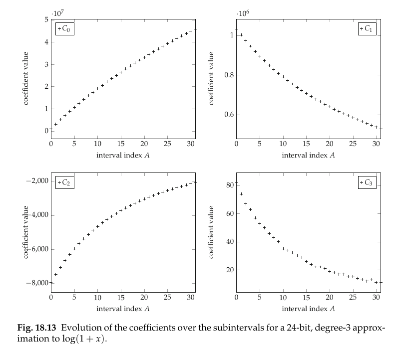

# Polynomial Coefficient Table

A ROM addressed by the segment index that emits all $d+1$ coefficients of one subinterval's polynomial in parallel, and the only part of a polynomial function evaluator whose size is exponential in the target precision.

```tikz title="Coefficient table in a uniform-segmentation evaluator, with the packed word layout"
\usepackage{circuitikz}
\begin{document}
\begin{circuitikz}
\footnotesize
% ---------------- input word split (the address is a wire slice) ----------------
\node[anchor=east] at (-0.15,3.925) {$X=$};
\draw[thick,fill=gray!18] (0,3.65) rectangle (1.3,4.2);
\node at (0.65,3.925) {$A$};
\draw[thick] (1.3,3.65) rectangle (5.6,4.2);
\node at (3.45,3.925) {$Y$};
\draw[<->] (0,4.42) -- node[above,font=\tiny,inner sep=1pt]{$\alpha$} (1.3,4.42);
\draw[<->] (1.3,4.42) -- node[above,font=\tiny,inner sep=1pt]{$w_X-\alpha$} (5.6,4.42);

% ---------------- table and evaluator ----------------
\node[draw,thick,minimum width=2.5cm,minimum height=1.9cm,align=center] (tab) at (1.0,1.75)
  {polynomial\\coefficient\\table\\[1pt]{\tiny $2^{\alpha}$ words $\times\ W$ bits}};
\node[draw,thick,minimum width=2.3cm,minimum height=1.9cm,align=center] (ev) at (7.3,1.75)
  {polynomial\\evaluator};

% address in
\draw[->,thick] (0.65,3.65) -- (0.65,2.7);
\node[anchor=east,font=\tiny] at (0.60,3.15) {$A$};
% reduced argument routed over the table
\draw[->,thick] (3.45,3.65) -- (3.45,3.15) -- (7.3,3.15) -- (7.3,2.7);
\node[anchor=south,font=\tiny] at (5.4,3.17) {$Y$, $w_X-\alpha$};
% coefficient buses
\draw[->,thick] (2.25,2.35) -- node[above,font=\tiny]{$C_0$: $(m_0,\ell_p)$} (6.15,2.35);
\draw[->,thick] (2.25,1.75) -- node[above,font=\tiny]{$C_1$: $(m_1,\ell_p)$} (6.15,1.75);
\node[font=\tiny] at (3.1,1.38) {$\vdots$};
\draw[->,thick] (2.25,1.00) -- node[above,font=\tiny]{$C_d$: $(m_d,\ell_p)$} (6.15,1.00);
% result
\draw[->,thick] (8.45,1.75) -- (9.9,1.75);
\node[anchor=west,font=\tiny] at (9.0,1.95) {$w_R$};
\node[anchor=west] at (9.95,1.75) {$R$};

% ---------------- the stored word ----------------
\node[anchor=west,font=\small] at (-0.5,-1.05) {one word:};
\draw[thick,dashed,fill=gray!30] (1.75,-1.35) rectangle (2.05,-0.75);
\draw[thick] (2.05,-1.35) rectangle (4.45,-0.75);
\node at (3.25,-1.05) {$C_0$};
\draw[thick,dashed,fill=gray!30] (4.45,-1.35) rectangle (4.75,-0.75);
\draw[thick] (4.75,-1.35) rectangle (6.95,-0.75);
\node at (5.85,-1.05) {$C_1$};
\draw[thick,dashed,fill=gray!30] (6.95,-1.35) rectangle (7.25,-0.75);
\draw[thick] (7.25,-1.35) rectangle (9.05,-0.75);
\node at (8.15,-1.05) {$C_2$};
\node[font=\tiny] at (9.30,-1.05) {$\cdots$};
\draw[thick,dashed,fill=gray!30] (9.55,-1.35) rectangle (9.85,-0.75);
\draw[thick] (9.85,-1.35) rectangle (10.85,-0.75);
\node at (10.35,-1.05) {$C_d$};

\draw[<->] (2.05,-1.52) -- node[below,font=\tiny,inner sep=1pt]{$m_0-\ell_p+1$} (4.45,-1.52);
\draw[<->] (4.75,-1.52) -- node[below,font=\tiny,inner sep=1pt]{$m_1-\ell_p+1$} (6.95,-1.52);
\draw[<->] (7.25,-1.52) -- node[below,font=\tiny,inner sep=1pt]{$m_2-\ell_p+1$} (9.05,-1.52);

\node[anchor=west,font=\tiny,align=left] at (1.15,0.42)
  {fields narrow by $\approx\alpha$ bits per degree, since $C_i\approx\frac{f^{(i)}}{i!}2^{-i\alpha}$};
\node[anchor=west,font=\tiny,align=left] at (1.15,0.00)
  {dashed = sign bit, \emph{not} stored: tied to the constant $\operatorname{sgn}C_i$};
\draw[->] (1.10,0.00) -- (1.88,-0.78);

\node[anchor=west,font=\tiny,align=left] at (-0.5,-2.35)
  {$W=\sum_{i=0}^{d}(m_i-\ell_p+1)$ magnitude bits per word, $2^{\alpha}W$ bits in all. Worked example
   $f=\log_2(1+X)$, $w_X=w_R=12$, $\alpha=3$, $d=2$,\\ $\ell_p=-15$: $m=(-1,-3,-7)$, fields
   $15\,|\,13\,|\,9$, so $W=37$ and the table is $8\times37=296$ bits --- against $320$ with the
   three sign bits stored.};
\end{circuitikz}
\end{document}
```

*after Fig. 18.10, p. 542; the word layout below the dashed line is my own construction.*

**The address costs nothing, and that is why uniform segmentation is the default.** Under [[Uniform Piecewise Segmentation]] the change of variable $X=2^{-\alpha}(A+Y)$ is exact and is a pure wire split: $A$ is the top $\alpha$ bits of $X$ interpreted as an integer, $Y$ the bottom $w_X-\alpha$ (Eq. 18.3, Fig. 18.9, p. 541). The table's address port is therefore *soldered* to $X[w_X-1:w_X-\alpha]$ — no decoder, no arithmetic, no delay before the memory. Depth is exactly $2^{\alpha}$ with no unused entries. Every other reduction pays to produce $A$: [[Logarithmic Segmentation]] a leading-zero counter, [[Hierarchical Segmentation]] a second table plus an adder $\Delta(A_1)+A_2$, [[Dichotomy-Based Segmentation]] a comparator tree. Those costs sit *in front of* the memory, on the critical path, which is why they are only taken when the function forces them.

**Size each field for the worst subinterval, because one bus serves all $2^{\alpha}$ of them.** Running the coefficient search of [[Remez Minimax]] on subinterval $A$ returns a polynomial whose coefficients have their own fixed-point formats $(m_i(A),\ell_i(A))$. Those formats cannot be per-address — $A$ is a runtime value and the wires leaving the ROM are physical — so the generator takes the envelope (Eqs. 18.7–18.8, p. 543):

$$m_i=\max_A m_i(A),\qquad \ell_p=\min_A \ell_i(A).$$

A field of format $(m_i,\ell_p)$ — MSB of weight $2^{m_i}$, LSB of weight $2^{\ell_p}$ — is $m_i-\ell_p+1$ bits (format conventions in [[Number Formats]]). Summing over degrees gives the word width $W$ in the diagram, and the whole table is $2^{\alpha}W$ bits.

**One LSB for every degree, a staircase of MSBs.** The shared $\ell_p$ is not a simplification, it is the right answer: normalization puts $|Y|\le1$, so $|C_iY^i|\le|C_i|$ and every monomial can be as inaccurate as every other — the sum is no better than its worst term, so equalizing the LSBs wastes nothing. The MSBs are the opposite. After a reduction of parameter $\alpha$ the $i$-th coefficient is $C_i\approx\frac{f^{(i)}}{i!}2^{-i\alpha}$, so $m_i\approx m_0-i\alpha$: **each field is about $\alpha$ bits narrower than the one before it**, and

$$W\ \approx\ (d+1)(m_0-\ell_p+1)\ -\ \alpha\frac{d(d+1)}{2}.$$

For $f=\log_2(1+X)$ at $w_X=w_R=24$, $d=3$, $\alpha=5$ the fields measure $27,23,17,11$ — decrements $4,6,6$ against a predicted $5$. The same decay is what makes [[Horner Evaluation]] shrink its multipliers stage by stage; it is one fact with two consequences.

**The exponential lives here and nowhere else.** The two scaling laws force $\alpha(d+1)\gtrsim w_R$, so $\alpha\approx w_R/(d+1)$ and the table is $\Theta\!\left(2^{w_R/(d+1)}\right)$ bits, while the arithmetic is $d$ multipliers and $d$ adders — linear in the degree, polynomial in the widths. Every knob in this family is therefore a knob on *this* memory. Measured for $\log_2(1+X)$ at 24 bits:

| $d$ | $\alpha$ | $W$ | table bits |
| --- | --- | --- | --- |
| 1 | 12 | 41 | $167\,936$ |
| 2 | 7 | 61 | $7808$ |
| 3 | 5 | 78 | $2496$ |
| 4 | 3 | 114 | $912$ |

The first multiplier buys a factor $21$, the second only $3.1$, the third $2.7$ — the argument that settles $d$ at 2 or 3 is worked in [[Choosing a Polynomial Evaluator]].

**Never store a bit whose value you already know.** It is typical, though not automatic, that all $2^{\alpha}$ coefficients of a given degree share a sign: good approximations inherit the monotonicity and convexity of $f$, and those properties *are* the signs of the successive derivatives $f^{(i)}$, which the $C_i$ track. When they do, the MSB of the two's-complement field is a constant, so it becomes a wire tied to $\operatorname{sgn}C_i$ and the ROM stores only the remaining $m_i-\ell_p$ bits — $(d+1)2^{\alpha}$ bits saved, for nothing. The book is emphatic that this is an empirical check, not a theorem (p. 547): tabulate the coefficients, look at the signs, and do not attempt the analysis.

**The coefficient curves are smooth, so the table compresses like a function table.**



*Fig. 18.13, p. 546 — cropped from the book rather than redrawn.*

Plotted against $A$, each coefficient traces a smooth curve; it would be perfectly smooth if the polynomials were Remez or Chebyshev, and the visible jitter is a machine-efficient-approximation artefact that concentrates on the highest-degree coefficient. Smoothness is exactly the precondition for Hsiao's lossless differential compression, which [[Multipartite Methods]] already applies to its $C_0$ table: split the address as $A=(A_H,A_L)$, store one coarse value per $A_H$ and a short signed offset per $A$, and reconstruct with an addition. The chapter's contribution is that this works on **every** coefficient table, not just the degree-0 one ([[Table-Based Function Evaluation]]). The addition is nearly free in context — it is one more row in the [[Sums of Weighted Bits|bit heap]] the evaluator already builds, and its delay hides because most coefficients are consumed late in the Horner chain. The one field that compresses worst is $C_d$, where the artefacts sit, and that is also the narrowest field, so little is lost.

> [!note] The smooth curves are also an invitation to delete the table
> If the regularity has a closed form, compute the coefficients instead of storing them: for $\sin(\frac\pi2X)$ the addition theorem expresses $C_1,C_2,C_3$ as scalings of $C_0$ and $C_1$, collapsing four tables into one ([[Addition-Theorem Coefficient Generation]]). A generic generator cannot find that; a designer who knows the function can.

**One free bit rides in $C_0$.** The architecture computes $R_{\text{ext}}$ wider than $\ell_R$ and truncates. Pre-adding a half-ulp $2^{\ell_R-1}$ into the stored $C_0$ turns that truncation into round-to-nearest at zero hardware cost, because it changes a constant rather than a circuit ([[Error Accuracy]]). $C_0$ is the cheap coefficient generally — it feeds only an addition, never a product — so when the fields are being balanced, extra LSBs are worth more there than anywhere else.

**On an FPGA the word shape matters as much as the bit count.** $2^{\alpha}$ words of $W$ bits is shallow and very wide, and a hard memory block has a bounded word width, so a $W$-bit word is spread across $\lceil W/w_{\max}\rceil$ [[Block Memory|block RAMs]] driven by one shared address; the count of blocks is set by $W$, not by $2^{\alpha}$, until $\alpha$ grows past a block's depth. Below that there is a cheaper option: a $k$-input [[Lookup-Tables|LUT]] *is* a $2^k\times1$ ROM, so for $\alpha\le k$ the entire coefficient table costs exactly $W$ LUTs and no block memory at all — which covers the $d=3,\alpha=5$ and $d=4,\alpha=3$ rows above on any 6-LUT fabric. Since this table is the only exponential resource in the operator, the practical design loop runs backwards: pick the memory you are willing to spend, and let it fix $\alpha$ and hence $d$ ([[FPGAs]]).

> [!warning] Chapter 18 reports no synthesis numbers
> The chapter gives no LUT, BRAM or delay figures for any of its architectures. The table sizes above are bit counts computed from the book's own equations; the mapping arguments in this paragraph are standard FPGA reasoning, not measurements.

$$\boxed{\ \text{table bits}=2^{\alpha}\sum_{i=0}^{d}\left(m_i-\ell_p+1\right),\qquad m_i=\max_A m_i(A),\quad \ell_p=\min_A\ell_i(A),\quad \alpha\approx\frac{w_R}{d+1}\ }$$

**When it breaks.**

- $\alpha$ is a doubling knob: one more segment level doubles the memory to buy $d+1$ bits of accuracy. Past $\alpha\approx12$ nothing fits and the only move left is to raise $d$.
- Worst-case sizing spends bits on the easy subintervals to satisfy the hard ones. The repair is to hoist the loop over $A$ *inside* the coefficient search so all subintervals share one $\ell_p$ from the start — the spare LSBs then hold more accurate coefficients instead of zeros, shrinking $\bar\delta_{\text{approx}}$ for free (p. 565). The [[ILP-Optimized Polynomial Evaluator]] removes the worst case entirely by making the coefficient bits the decision variables.
- Constant signs are a property of the function, not of the method. A coefficient that changes sign across $A$ keeps its sign bit; check, do not assume.
- Differential compression assumes the curves are smooth. It degrades exactly where the machine-efficient search wobbles, on $C_d$, and it does not survive a segmentation whose subintervals are not in a natural order.
- Non-uniform segmentation breaks the free address and often the power-of-two depth: [[Dichotomy-Based Segmentation]] needs a search to produce $A$ and also a $w_X$-bit midpoint $M_A$ per entry, which is extra table.
- Under [[Logarithmic Segmentation]] the two leftmost subintervals are single points where the polynomial degenerates to $C_0$; those entries carry full-width fields for coefficients that are identically zero.
- Tabulating function values instead of coefficients ([[Function-Value Interpolation]]) inverts the scaling — the table then *grows* with the degree instead of shrinking — which is why it loses.

**RTL (Spade).** The table for the note's worked example: $f=\log_2(1+X)$, $w_X=w_R=12$, $\alpha=3$, $d=2$, $\ell_p=-15$, half-ulp folded into $C_0$, all three sign bits hardwired.

```spade
/// Word layout, MSB first:  C0 (15 b) : C1 (13 b) : C2 (9 b) = W = 37 bits.
/// Every C0 and C1 is positive and every C2 is negative on all 8 subintervals,
/// so no sign bit is stored: the 9 bits of C2 are the low bits of its 10-bit
/// two's-complement value and the sign bit is a wire tied to 1.
fn coeff_rom(a: uint<3>) -> uint<37> {
    match a {
        0 => 0b000000000000101_1011100000110_010111000,
        1 => 0b001010111000101_1010001111010_011111010,
        2 => 0b010100100111001_1001001101111_100101001,
        3 => 0b011101011010011_1000011000100_101001101,
        4 => 0b100101011100100_0111101011111_101101001,
        5 => 0b101100110101100_0111000110001_101111110,
        6 => 0b110011101011100_0110100101110_110010000,
        7 => 0b111010000011001_0110001001101_110011110,
        _ => 0,
    }
}

/// Address decode, field split, constant-sign reinsertion.
/// Output bus, MSB first: C0 (15 b) : C1 (13 b) : C2 (10 b, two's complement).
entity coeff3(a: uint<3>) -> uint<38> {
    let bits = coeff_rom(a).as_bits();
    let c0: uint<15> = bits[22..37].as_uint();
    let c1: uint<13> = bits[9..22].as_uint();
    let c2_low: uint<9> = bits[0..9].as_uint();
    let sign: uint<1> = 1;              // hardwired: every C2 is negative
    let c2: int<10> = sign.concat(c2_low).as_int();
    c0.concat(c1).concat(c2.as_uint())
}
```

`a` is the shaded $A$ field of the diagram and `coeff_rom` is the box; the three slices of `bits` are the three fields of the word strip, with `.as_bits()` indexing from the LSB so the $C_0$ field is the *high* range `[22..37]`. The dashed cell is `sign`: a literal `1` concatenated on, which costs a wire, whereas storing $C_2$ as a 10-bit signed field would cost $8$ more ROM bits and negating a stored magnitude would cost an adder. The block is combinational and unclocked — synthesis will infer $37$ LUT-ROMs at $\alpha=3$, and a real design registers the output so the tool can infer block RAM instead, which adds a cycle of latency the drawing does not show.

Simulated with an integer Horner evaluation ($\ell^S=-16$, $Y$ untruncated) driven by the table's own outputs and checked against $\log_2(1+X)$: **7101 checks, 0 failures**, covering all $4096$ inputs exhaustively plus a 3000-vector random sweep, the asymmetric named vector $A=1$, $Y=101101001_2$, and an assertion that $C_2$ comes out negative at every address. Worst observed error $0.73$ ulp — faithful, matching the $0.76$ ulp bound the budget predicts.

**Related notes.**

- [[Uniform Piecewise Segmentation]] – depends-on: makes the address a wire slice and fixes the depth at $2^{\alpha}$.
- [[Remez Minimax]] – depends-on: produces the per-subinterval $(m_i(A),\ell_i(A))$ that the max/min envelope collapses into one word format.
- [[Horner Evaluation]] – supports: the consumer of the buses; the same $\approx\alpha$-bits-per-degree decay narrows its multipliers.
- [[Choosing a Polynomial Evaluator]] – compares: turns $2^{\alpha}W$ against $d$ multipliers into an actual choice of $d$.
- [[Multipartite Methods]] – compares: a degree-1 evaluator whose $C_1\cdot Y$ product is itself tabulated, and the origin of the differential compression reused here.
- [[Table-Based Function Evaluation]] – compares: the $\Theta(2^{w_X/2})$ regime this table escapes by carrying coefficients instead of values.
- [[Addition-Theorem Coefficient Generation]] – counter-example: when the coefficients obey an identity, the table is computed rather than stored.
- [[Function-Value Interpolation]] – counter-example: tabulates $f$ instead of the $C_i$, and scales the wrong way with degree.
- [[Block Memory]] – supports: the resource a wide shallow word maps onto once $\alpha$ exceeds a LUT's address depth.
- [[Lookup-Tables]] – supports: for $\alpha\le k$ the whole table is $W$ $k$-LUTs and touches no hard memory.
- [[ILP-Optimized Polynomial Evaluator]] – extends: makes the stored bits themselves the optimization variables, deleting the worst-case envelope.
- [[Sums of Weighted Bits]] – supports: absorbs the compression adder, which is why differential compression is close to free.

## References

de Dinechin & Kumm, *Application-Specific Arithmetic*, Springer 2024, Ch. 18 "Polynomial-Based Architectures for Function Evaluation".

- §18.2.1 "Range Reduction by Uniform Piecewise Splitting", pp. 541–543 — Fig. 18.9 (input word decomposition), Fig. 18.10 (uniform segmentation architecture, redrawn above), Eq. (18.3), the memory/arithmetic trade-off.
- §18.2.1.3 "Coefficient Sizing", p. 543 — Eqs. (18.7)–(18.8), the worst-case envelope, and the shared-$\ell_p$ refinement.
- §18.2.1.4 "Coefficient Compression Opportunities", pp. 544–547 — Figs. 18.12–18.14 (coefficient smoothness; Fig. 18.13 cropped above), Hsiao's compression applied to every coefficient.
- §18.2.1.5 "Coefficients with Constant Signs", p. 547 — one bit per coefficient, checked numerically.
- §18.2.2 "Interpolation", pp. 547–548 — the scaling argument against tabulating function values.
- §18.4 "Putting It All Together", p. 563 — the half-ulp pre-added into $C_0$; p. 565 — hoisting the loop over $A$ inside the coefficient search.
- Long-form [[Polynomial Approximation]] — the computed table-size and coefficient-width figures, and the $w_X=w_R=12$ worked example the RTL implements.
