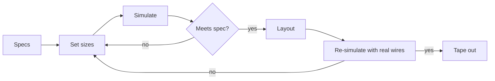
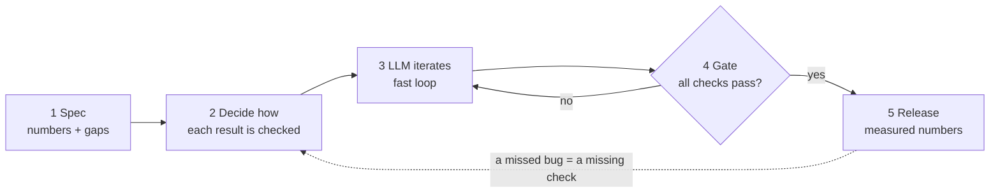

Pre-req reads: [[Tooling]]

To understand why all this tooling is required, it helps to understand the typical + LLM-enhanced workflow's requirements, and which tooling is typically involved.

## How analog design works

Analog has no compiler. The designer picks a circuit shape, then sets every transistor size, resistor and capacitor by hand. Each value is a knob, and the knobs trade against each other (speed vs power, noise vs area). The only way to know whether a design works is to **simulate** it:

A single check is really hundreds of simulations: every temperature/supply/process **corner**, plus thousands of **Monte Carlo** runs for random manufacturing variation.

**Without LLMs** the designer is the optimizer. Every iteration is a human guess followed by a wait for simulations, so a design gets tens of tries, guided by years of intuition.

**With LLMs** the LLM turns the knobs and the designer sets specs and judges results. A design can get thousands of tries. That only helps if every step below holds, because a machine iterating fast will just as quickly iterate toward a wrong answer.

## The LLM-enhanced workflow

### 1. Write the spec so a machine can work from it
Every block states **what goes in, what comes out, and what it does**. Every number comes with its derivation (why 16 mA, why 21 GHz), so the LLM can redo the arithmetic when something changes. Anything not yet decided is marked as an explicit **Gap** rather than silently assumed. Example: [[Blogs/PAM4 SerDes.txt|PAM4 SerDes spec]].

### 2. Decide how each result will be checked, before designing
"It simulated and looked fine" is not a check. Each result needs an independent way to say it's wrong. That way is called an **oracle**:

| Oracle | Example |
|---|---|
| Hand-worked answer | an RC step response computed on paper |
| Second opinion | the same circuit in an established simulator must agree |
| Predictable transformation | renumber the nodes and the answer is identical; scale every impedance by k and the currents scale by 1/k |
| Cheap self-check | plug the solution back in: currents into each node must sum to zero |

Coverage ("every case ran") is not enough. A run that finishes with the wrong number passes every crash test. Checks get cheaper per run as you go down this list, and the cheap ones run on every change.

### 3. Keep the loop fast
The LLM's speed is capped by how long each try takes. Unchanged work is never redone, sweeps/corners/Monte Carlo run in parallel, and quick checks run on every edit while the full suite runs less often:

| When | Budget | Runs |
|---|---|---|
| Every edit | seconds | quick sanity checks |
| Every accepted change | minutes | all checks, every corner |
| Nightly | hours | large Monte Carlo, long random searches, comparison against reference tools |
| Before release | unbounded | everything |

### 4. Gate: the machine says no, not a person
A change is accepted only if every check passes, so the working version is never broken. Tolerances are never loosened to make a check pass. Every known failure is written down with a reason, and the check fails again if that reason goes away. A flaky check gets fixed the same day, because a gate that sometimes lies stops being trusted.

### 5. Release on numbers
A design (or tool version) ships only when a script confirms every number: all checks pass, results agree with reference tools within the stated tolerance, the same input gives the same output every run, and there is a written list of what is still unverified. Every input is **pinned** (exact model files, exact tool versions), so anyone can reproduce the result later.

## Where the tooling comes in

| Bottleneck | What the tooling does |
|---|---|
| Simulation is slow | Runs many design points at once, so sweeps, corners and Monte Carlo run in parallel |
| Tools are closed, GUI or niche-script driven | Open tools driven from real programming languages, with drop-in custom blocks |
| LLM thinks in netlists, humans in schematics | Converts netlist ↔ schematic both ways, so both see the same circuit |
| LLM wastes effort on standard measurements | Ready-made testbenches |
| A wrong number looks like a right one | Simulator itself checked with the oracles above against established references |

## The result

| | Without LLMs | With LLMs + this workflow |
|---|---|---|
| Who iterates | designer | LLM |
| Designer's job | turn knobs | write the spec, choose the checks, judge results |
| Tries per design | tens | thousands |
| Limit | human time | simulation speed |
| Outcome | one passing design | the range of passing designs and their trade-offs, with evidence |
